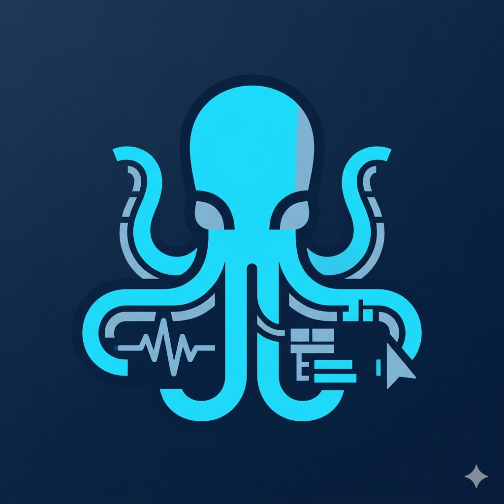
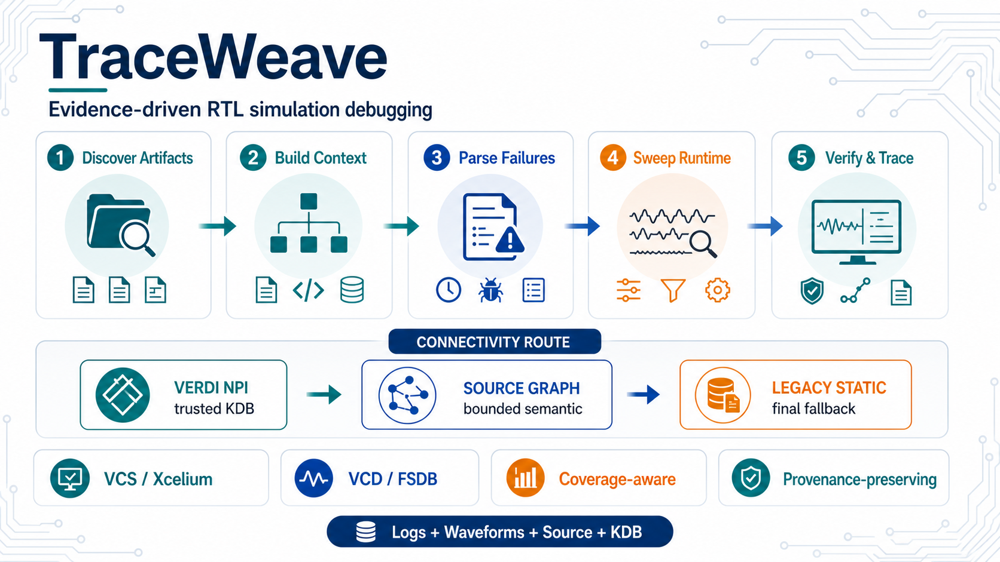

# 🐙 TraceWeave

<!-- mcp-name: io.github.gokeshenzhen/traceweave -->

<p align="right">
  <strong>English</strong> · <a href="https://github.com/gokeshenzhen/TraceWeave/blob/main/README.zh.md">简体中文</a>
</p>

<p align="center">
  
</p>

<p align="center">
  <strong>An MCP server for evidence-driven simulation debugging</strong>
</p>

<p align="center">
  <a href="https://github.com/gokeshenzhen/TraceWeave/actions/workflows/ci.yml"></a>
  <a href="https://pypi.org/project/traceweave-mcp/"></a>
  <a href="https://github.com/gokeshenzhen/TraceWeave/blob/main/LICENSE"></a>
  <a href="https://www.python.org/"></a>
  <a href="https://github.com/gokeshenzhen/TraceWeave/stargazers"></a>
</p>

TraceWeave is an MCP server for RTL / SoC debugging. It connects compile records, simulation logs, VCD/FSDB/FST waveforms, and RTL source to your AI assistant, helping you work from a failed simulation to the relevant time, signals, and driving logic.

Use it with Claude Code, Codex, Copilot, or another MCP client. Describe the problem in natural language; the assistant uses tools to investigate, trace, and verify, with evidence you can review.

[Use Cases](#use-cases) · [Installation](#installation) · [Client Setup](#client-setup) · [Start Debugging](#start-debugging) · [Tool Quick Reference](#tool-quick-reference) · [FAQ](#faq) · [Documentation and Feedback](#documentation-and-feedback)

<p align="center">
  
</p>

## Use Cases

| Problem | How TraceWeave helps |
|---|---|
| A simulation times out or hangs, with no clear starting point | Summarize failures and scan interface handshakes to narrow down the affected interfaces and time window |
| A scoreboard mismatch or different results between runs | Compare failure records and waveforms, locate observed differences, and trace data and control sources on both sides |
| A signal becomes X/Z | Follow drivers and review waveform history to check whether a register sampled and retained an unknown value |
| Packed buses are hard to read, or TL-UL requests are not completing | Inspect address, data, and control fields individually, then check request/response handshakes, latency, and completion |
| Suspected ties, unconnected inputs, or magic-word conditions | Statically scan source code for constant connections, open inputs, and constant comparisons as investigation leads; no simulation run or waveform required |
| A deep SoC hierarchy with many modules and interfaces | Browse hierarchy on demand, locate instances and source files, and follow drivers, consumers, and connectivity paths |
| A debugging hypothesis needs evidence | Sample by cycle and check timing conditions, handshake stability, and transaction completion |

Supports VCS / Xcelium / Verilator simulation logs and VCD / FSDB / FST waveforms. Exported formal waveforms can also be queried; automatic artifact discovery currently supports JasperGold.

Trace signals from the waveform back to their driving logic with **Verdi NPI → Source Graph → basic static analysis**, according to available tools and query coverage. Source Graph provides semantic source analysis without a commercial license. Results retain source references, coverage gaps, and next steps so you can check the evidence before assigning a root cause.

## Installation

Requires **Python 3.11+**. Choose the installation that fits your environment:

| Installation | Intended use |
|---|---|
| Repository | Simulation hosts with an existing Verdi installation, for FSDB, Source Graph, and optional NPI / LSF |
| PyPI | Log and VCD analysis, or Source Graph without a commercial license |

### Repository Installation

```bash
git clone https://github.com/gokeshenzhen/TraceWeave.git
cd TraceWeave
export VERDI_HOME=/path/to/verdi
bash scripts/install.sh
```

The installer prepares the Python environment, Source Graph, and FSDB reader, then checks the runtime. It leaves shell startup files and MCP client configuration untouched. FSDB support builds against the Synopsys FSDB Reader SDK in `VERDI_HOME`; TraceWeave does not redistribute its headers or libraries. Use of the FSDB Reader is subject to the applicable VC Apps Access Program Agreement (or successor). NPI and KDB operations also require the appropriate EDA runtime and license from your site.

For an existing installation, start with a read-only check:

```bash
bash scripts/install.sh --check
```

### PyPI Installation

```bash
python3.11 -m pip install "traceweave-mcp[source-graph]"
traceweave-mcp --doctor
```

For logs, VCD, and basic static analysis only, install `traceweave-mcp` without `[source-graph]`. The PyPI package does not include the FSDB reader; use the repository installation for FSDB.

### Optional FST support

On Linux, install `traceweave-mcp[fst]` in the server environment; repository users can install `pylibfst==0.2.1` with `.venv/bin/python -m pip install`. Reconnect the server and check waveform discovery. See [FST support and limits](docs/architecture.md#fst-basic-reading).

## Client Setup

After a repository installation, generate a client configuration template with absolute paths:

| Client | Generate configuration template |
|---|---|
| Claude Code | `bash scripts/install.sh --print-config claude` |
| Codex | `bash scripts/install.sh --print-config codex` |
| Copilot | `bash scripts/install.sh --print-config copilot` |

These commands only print templates. Add the output to your client's MCP configuration, supply any required site EDA environment variables, and reconnect the server. See the [client configuration reference](https://github.com/gokeshenzhen/TraceWeave/blob/main/docs/architecture.md#client-configuration-reference) for complete examples.

Other MCP clients supporting stdio can use these connection settings:

| Installation | `command` | `args` |
|---|---|---|
| Repository | `<absolute-repository-path>/.venv/bin/python` | `["<absolute-repository-path>/server.py"]` |
| PyPI | `traceweave-mcp`, or its absolute path | `[]` |

If a proxy slows NPI SDK initialization and direct vendor access is available,
set `TRACEWEAVE_NPI_VENDOR_DIRECT=1` in the MCP server environment and reconnect.
It defaults to off; startup commands stay the same. Before the first SDK import,
it appends `srv1.sw.synopsys.com` and `.updates.synopsys.com` to the process's
`NO_PROXY`/`no_proxy`, preserving existing entries. It does not edit proxy
configuration or disable SDK communication/retries; offline environments have
no guaranteed benefit. For LSF, the worker environment must also receive the flag.

### LSF-only NPI licenses

If Verdi/NPI licenses are available only on LSF compute nodes, provide these settings to the MCP server process. Replace `digital` with your queue:

```bash
export TRACEWEAVE_NPI_EXECUTION=lsf
export TRACEWEAVE_NPI_LSF_QUEUE="digital"
```

The client must inherit or explicitly pass these variables. Project files, the TraceWeave installation, and cache directories must be visible at the same absolute paths on submission and compute nodes. See the [LSF configuration reference](https://github.com/gokeshenzhen/TraceWeave/blob/main/docs/architecture.md#lsf-only-npi-licenses) for bash / tcsh examples, client environment forwarding, and verification steps.

## Start Debugging

Connect your assistant and ask, replacing the path with your project directory:

> Use TraceWeave to investigate the simulation failure in `my_case` under `/path/to/verif`. Check logs, design structure, and interface handshakes, then trace suspicious signals. Include timestamps, signal paths, and source references.

The default investigation discovers run artifacts, prepares a design context and scans structural risks in parallel, then parses failures and sweeps handshakes when a failed run has a waveform. The assistant uses that context to browse source and trace signals on demand. A full hierarchy build remains available when explicitly needed.

Try a more focused question:

- **Find a mismatch:** “Compare `tb.dut.result` in these two waveforms and trace the logic producing the difference on each side.”
- **Trace an X:** “`tb.dut.q` is X at 36 ns, but its input is now known. Check earlier sampling and hold behavior from 0 to 36 ns.”
- **Inspect transactions:** “Check this TL-UL interface from 10 to 20 μs for stalls, response latency, and outstanding requests.”
- **Check source structure:** “Use deep mode to scan this compile log's design for suspicious ties, open inputs, and constant comparisons.”
- **Verify a hypothesis:** “Sample these signals before each clock edge and check whether the payload stays stable while waiting for ready.”

You can also evaluate [SV expressions](docs/expressions.md), inspect packed bus fields, and compare failures after a fix. Coverage limits remain visible: zero findings from an incomplete check do not establish that the design is correct.

For a connection check, ask the assistant to call `get_sim_paths`. See the [debug workflow](docs/workflow.md) for the full procedure and the [readback check](docs/architecture.md#readback-client-check) for a repository smoke check.

### Custom runtime logs

Built-in parsing covers UVM, VCS/Xcelium assertions, and supported Verilator/cocotb failures. Add project-specific checker labels through [custom_patterns.yaml](custom_patterns.yaml), or set `TRACEWEAVE_CUSTOM_PATTERNS_FILE` to your own file. See [log formats and configuration](docs/architecture.md#runtime-log-formats) for examples and Verilator time-unit requirements.

## Tool Quick Reference

Describe your debugging goal and let the assistant choose the tools. All tools are listed below; consult their MCP definitions for parameters and supported scope.

| Category | Tool | Purpose |
|---|---|---|
| Session and artifacts | `get_sim_paths` | Discover compile logs, simulation logs, and waveforms |
|  | `get_formal_paths` | Discover JasperGold projects and exported waveforms |
|  | `get_diagnostic_snapshot` | Review collected evidence and suggested steps |
| Design and source | `prepare_design_context` | Prepare a design context for on-demand queries |
|  | `build_tb_hierarchy` | Explicitly build an RTL / testbench hierarchy view |
|  | `get_tb_subtree` | Browse a selected instance subtree |
|  | `find_tb_instance` | Find instances by path or module name |
|  | `lookup_tb_files` | Find source files in the compiled input set |
|  | `get_tb_file_detail` | Inspect module, interface, and class declarations |
|  | `get_tb_class_hierarchy` | Browse SystemVerilog / UVM class inheritance |
|  | `dump_tb_section` | Export a selected hierarchy or source section |
| Logs and failures | `parse_sim_log` | Group runtime failures and extract times and summaries |
|  | `get_error_context` | Read original log lines around an error |
|  | `diff_sim_failure_results` | Compare failures between runs |
|  | `analyze_failures` | Combine log and waveform evidence for a failure group |
|  | `analyze_failure_event` | Correlate one failure with instance, signal, and source leads |
|  | `recommend_failure_debug_next_steps` | Suggest investigation targets and next tool calls |
| Structure and tracing | `scan_structural_risks` | Scan text rules and NPI port facts; deep can supplement source semantics |
|  | `explain_signal_driver` | Trace signal drivers and source locations |
|  | `find_signal_loads` | Find signal consumers and loads |
|  | `trace_signal_path` | Query structural connectivity between signals |
|  | `trace_x_source` | Trace X/Z propagation and historical sampling |
| Waveform reads | `get_waveform_summary` | Inspect duration, signal counts, and timescale |
|  | `search_signals` | Search for full signal paths |
|  | `get_signal_at_time` | Read a value or expression at a selected time |
|  | `get_signal_transitions` | Read transitions within a time window |
|  | `get_signals_around_time` | Inspect multiple signals around a selected time |
|  | `get_signals_by_cycle` | Sample signals or expressions on clock edges |
| Differences and timing | `diff_first_divergence` | Locate the first confirmed known-value difference |
|  | `trace_divergence` | Backtrace data, control, and prior state on both sides of a difference |
|  | `period` | Check periods and cadence anomalies |
|  | `verify_window` | Check temporal conditions in a waveform window |
| Protocols and transactions | `suggest_handshakes` | Discover valid/ready signal bundles |
|  | `suggest_protocol_bundles` | Discover AHB / APB signal bundles |
|  | `sweep_handshakes` | Sweep discovered AHB / valid-ready interfaces for anomalies |
|  | `inspect_handshake` | Inspect stalls and hold behavior on one interface |
|  | `reconstruct_transactions` | Reconstruct requests/responses, latency, and outstanding requests |
|  | `resolve_packed_fields` | Resolve packed fields and verify waveform coordinates |
|  | `inspect_tlul` | Inspect TL-UL handshakes and requests/responses |
| Time cursors | `cursor_set` | Name a key timestamp |
|  | `cursor_list` | List session cursors |
|  | `cursor_delete` | Delete a time cursor |
| EDA integration | `build_kdb` | Build and cache a Verdi KDB |

### Native-first design queries

After `get_sim_paths`, run `scan_structural_risks` as usual, then continue log
and waveform investigation. Connectivity, hierarchy/file/class queries, X traces,
packed layouts and failure correlation accept `compile_log` directly. They try
healthy NPI using bounded metadata and an existing KDB, without full source
capture or source validation. With no log, provide `kdb_path` and `top_hint`;
compile file ownership and source fallback still require a log. KDB-only failure
analysis/recommendation also requires an explicit `simulator` for log parsing.

```python
find_tb_instance(compile_log="/project/compile.log", path="tb.dut")
explain_signal_driver(kdb_path="/project/simv.daidir/kdb.elab++",
                      top_hint="tb", signal_path="tb.dut.q", wave_path="/project/run.fsdb")
```

Ordinary native unavailability prepares source within the same request. Inspect
`native_route`: metadata, KDB and source identities are separate; the KDB/source
association stays `unverified`. Fallback returns a real `source_design_handle`
for explicit reuse. A changed source observation fails strictly; explicitly
prepare a new context and pass its new handle. `backend_preference="source"`
skips KDB discovery. `retry_npi=true` retries a remembered load failure for the
same KDB generation; per-tool capability gaps never disable other native tools.
All phases share `timeout_sec` (finite, at most 300 seconds).

`prepare_design_context` remains the explicit full source identity/recovery API.
Legacy handles and historical actions keep their original contracts. File
results distinguish `ownership_basis="compile_metadata"`/`source_status="not_captured"`
from captured source ownership. Metadata name/path filters and the three compile
record exports need neither KDB nor a semantic provider. Cached KDB discovery
still performs its exact source hash and reports that cost separately. No KDB
is automatically built. Scan and failed-run waveform sweep coverage remain
independent requirements; zero coverage is never a clean result.

## FAQ

**Can I use it without a commercial license?**

Log analysis, VCD, optional FST, lexical structural checks, and Slang / Source Graph analysis need no commercial license. Structural scans in `auto` / `deep` first try an existing KDB through NPI, which can request a license locally or through configured LSF. `fast` performs text checks only. FSDB uses your site's Verdi FSDB Reader under its applicable agreement; NPI and KDB builds require the corresponding EDA environment and license.

**Do I need simulation results for a structural scan?**

No. Supply a compile/elaboration log. Text checks use accessible sources; `auto` also tries existing/cached KDBs for NPI input-port checks, then only reuses compatible source semantic results for missing categories. `deep` additionally permits a bounded Slang build. Scans never build a KDB. Supply `top_hint` if compile metadata lacks a unique top.

Read `semantic.category_coverage` and `result_groups`: NPI port facts and source facts retain separate domains and identities. Default comparison checks still need source evidence; unknown expressions, empty-actual default semantics and budget stops remain gaps. Zero facts or a cache hit does not prove completeness. Findings can include legitimate tie-offs. See [scan modes and limits](docs/architecture.md#structural-scan-invocation).

For large designs, follow `semantic.suggested_next_action` or pass the returned
`semantic.continuation` as `semantic_continuation` with the same log/top/scope/categories.
Counts are cumulative; fact rows belong to the current page. Tokens expire after
ten idle minutes and survive neither server restart nor identity changes. For a
known target, query its exact `semantic_scope` directly.

**Can it inspect formal waveforms?**

Yes, exported waveforms use the same readers, with automatic JasperGold artifact discovery. Property results and reachability semantics still come from your formal tool or verification context.

**Where is design data processed?**

File parsing and EDA queries run locally or on configured LSF nodes. Returned evidence enters your AI client's context. Usage telemetry is off by default and writes locally when enabled.

## Documentation and Feedback

| Learn more about | Resource |
|---|---|
| Debugging steps and tool cooperation | [Debug workflow](https://github.com/gokeshenzhen/TraceWeave/blob/main/docs/workflow.md) |
| Verifying a root cause with evidence | [Debug discipline](https://github.com/gokeshenzhen/TraceWeave/blob/main/docs/debug-discipline.md) |
| Architecture, backend capabilities, and resource limits | [Architecture](https://github.com/gokeshenzhen/TraceWeave/blob/main/docs/architecture.md) |
| Expression inputs and worked examples | [SV expressions](docs/expressions.md) |
| Complete environment configuration and advanced settings | [Configuration reference](https://github.com/gokeshenzhen/TraceWeave/blob/main/docs/architecture.md#client-configuration-reference) |
| Reporting a problem or suggesting a feature | [GitHub Issues](https://github.com/gokeshenzhen/TraceWeave/issues) |

Before contributing, read [AGENTS.md](https://github.com/gokeshenzhen/TraceWeave/blob/main/AGENTS.md). With test dependencies installed, run `python3.11 -m pytest` from the repository root.

TraceWeave is available under the [MIT License](https://github.com/gokeshenzhen/TraceWeave/blob/main/LICENSE).

## WeChat

Follow the WeChat public account for project updates and debugging examples:

<p align="center">
  
</p>
