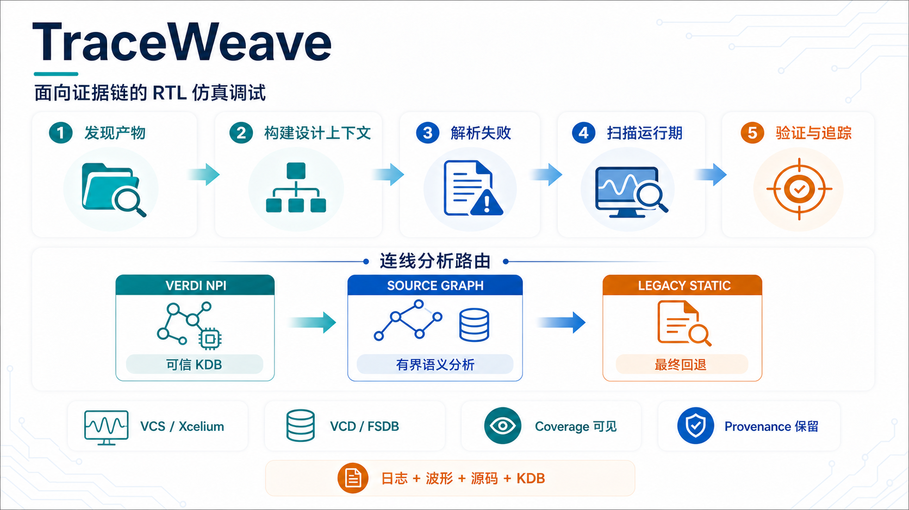

# 🐙 TraceWeave

<!-- mcp-name: io.github.gokeshenzhen/traceweave -->

<p align="right">
  <a href="README.md">English</a> · <strong>简体中文</strong>
</p>

<p align="center">
  
</p>

<p align="center">
  <strong>证据链驱动的仿真调试 MCP 服务器</strong>
</p>

<p align="center">
  <a href="https://github.com/gokeshenzhen/TraceWeave/actions/workflows/ci.yml"></a>
  <a href="https://pypi.org/project/traceweave-mcp/"></a>
  <a href="LICENSE"></a>
  <a href="https://www.python.org/"></a>
  <a href="https://github.com/gokeshenzhen/TraceWeave/stargazers"></a>
</p>

TraceWeave 是面向 RTL / SoC 调试的 MCP 服务器。它把编译记录、仿真日志、VCD/FSDB/FST 波形和 RTL 源码接入 AI 助手，帮助你从“仿真失败了”逐步定位到异常时刻、相关信号和驱动逻辑。

支持 Claude Code、Codex、Copilot 等 MCP 客户端。你用自然语言描述问题，助手通过工具查证、追踪和验证，返回可以复查的调试证据。

[适用场景](#适用场景) · [安装](#安装) · [客户端配置](#客户端配置) · [开始调试](#开始调试) · [工具速查](#工具速查) · [常见问题](#常见问题) · [文档与反馈](#文档与反馈)

<p align="center">
  
</p>

## 适用场景

| 遇到的问题 | TraceWeave 能帮助你做什么 |
|---|---|
| 仿真超时、卡死，不知道从哪里查起 | 汇总失败日志，扫描多接口握手行为，缩小异常接口和时间窗口 |
| Scoreboard mismatch、两次运行结果不同 | 对比失败记录与波形，定位已观测到的差异，并追踪两侧数据和控制来源 |
| 信号出现 X/Z | 沿驱动追踪传播路径，回看历史波形，检查寄存器是否曾采入并保持未知值 |
| 打包总线难读、TL-UL 请求迟迟没有响应 | 按字段查看地址、数据和控制信号，检查请求与响应的握手、延迟和完成情况 |
| 怀疑 tie 值、悬空输入或 magic word 条件 | 静态扫描源码，提取常量连接、未连接输入和常量比较等线索，供进一步核查；无需运行仿真或提供波形 |
| SoC 层级深、模块和接口多 | 按需浏览层次、查找实例与源码，追踪信号的驱动、消费者和连通路径 |
| 想验证一个调试假设 | 按周期采样，检查时序条件、握手保持和事务完成情况，取得具体证据 |

支持 VCS / Xcelium / Verilator 仿真日志及 VCD / FSDB / FST 波形。已有 formal 导出波形同样可查询；当前支持自动发现 JasperGold 产物。

信号追踪按 **Verdi NPI → Source Graph → 基础静态分析** 路由，结合可用工具与查询覆盖范围，从波形追到驱动逻辑。Source Graph 提供免商业 license 的语义源码分析；结果保留源码位置、覆盖缺口和后续调查方向，方便你核实证据，再判断根因。

## 安装

需要 **Python 3.11+**。按你的工作环境选择安装方式：

| 安装方式 | 适用场景 |
|---|---|
| 仓库安装 | 在已有 Verdi 环境的仿真主机上使用 FSDB、Source Graph，以及可选的 NPI / LSF |
| PyPI 安装 | 分析日志、VCD，或使用无需商业 license 的 Source Graph |

### 仓库安装

```bash
git clone https://github.com/gokeshenzhen/TraceWeave.git
cd TraceWeave
export VERDI_HOME=/path/to/verdi
bash scripts/install.sh
```

安装器准备 Python 环境、Source Graph 和 FSDB 读取组件，并检查运行环境。它不会修改 shell 启动文件或 MCP 客户端配置。FSDB 支持基于 `VERDI_HOME` 中的 Synopsys FSDB Reader SDK 构建；TraceWeave 不分发该 SDK 的头文件或库。使用 FSDB Reader 须遵守适用的 VC Apps Access Program Agreement（或其后续协议）。NPI 和 KDB 操作仍需站点提供相应的 EDA 运行环境和 license。

已有安装可先执行只读检查：

```bash
bash scripts/install.sh --check
```

### PyPI 安装

```bash
python3.11 -m pip install "traceweave-mcp[source-graph]"
traceweave-mcp --doctor
```

如果只需要日志、VCD 和基础静态分析，可安装 `traceweave-mcp`，省略 `[source-graph]`。PyPI 包不包含 FSDB 读取组件；需要 FSDB 时请选择仓库安装。

### 可选 FST 支持

**仅仓库版可用。** 仓库在 PyPI 2.0.2 发布后才加入 FST 读取器和 `fst` 可选依赖。在 Linux 上，从仓库根目录使用服务端的 Python 环境安装依赖并检查状态。

```bash
.venv/bin/python -m pip install "pylibfst==0.2.1"
.venv/bin/python -m traceweave_mcp --doctor
```

重新连接 MCP 服务器后，用 `get_waveform_summary` 打开一个小的 `.fst` 文件。返回的 `fst_backend.version` 是实际加载的读取器版本。详见 [FST 支持范围](docs/architecture.md#fst-basic-reading)。

## 客户端配置

仓库安装后，可生成带绝对路径的客户端配置模板：

| 客户端 | 生成配置模板 |
|---|---|
| Claude Code | `bash scripts/install.sh --print-config claude` |
| Codex | `bash scripts/install.sh --print-config codex` |
| Copilot | `bash scripts/install.sh --print-config copilot` |

命令只打印模板。将输出添加到对应客户端的 MCP 配置中，补充所需的站点 EDA 环境变量，然后重新连接服务器。完整示例见[客户端配置说明](docs/architecture.md#client-configuration-reference)。

其他支持 stdio 的 MCP 客户端也可使用以下连接参数：

| 安装方式 | `command` | `args` |
|---|---|---|
| 仓库安装 | `<仓库绝对路径>/.venv/bin/python` | `["<仓库绝对路径>/server.py"]` |
| PyPI 安装 | `traceweave-mcp`，或该命令的绝对路径 | `[]` |

若代理拖慢 NPI SDK 初始化，且厂商服务可直连，可在 MCP 服务环境中设置
`TRACEWEAVE_NPI_VENDOR_DIRECT=1` 后重新连接。默认关闭，启动命令不变；首次导入 SDK 前，
仅在当前进程的 `NO_PROXY`/`no_proxy` 中追加 `srv1.sw.synopsys.com` 和
`.updates.synopsys.com`，保留已有条目。不修改代理配置，也不关闭 SDK 通信或重试；
离线环境不保证受益。LSF 模式需确保执行节点的 worker 环境也获得该开关。

### 仅执行节点可用的 NPI License

如果 Verdi/NPI license 只能在 LSF 执行节点使用，让 MCP 服务进程获得以下设置，将 `digital` 换成你的队列：

```bash
export TRACEWEAVE_NPI_EXECUTION=lsf
export TRACEWEAVE_NPI_LSF_QUEUE="digital"
```

客户端需要继承或显式传入这些变量；相关工程文件与 TraceWeave 安装、缓存目录须在提交节点和执行节点以相同绝对路径可见。完整的 bash / tcsh、客户端环境转发和验证方法见 [LSF 配置说明](docs/architecture.md#lsf-only-npi-licenses)。

## 开始调试

连接助手后，替换工程路径，直接描述问题：

> 用 TraceWeave 调查 `/path/to/verif` 下 `my_case` 的仿真失败。检查日志、设计结构和接口握手，再追踪可疑信号。结论请附时间戳、信号路径和源码位置。

调查先定位当前运行产物，扫描结构风险并解析失败日志。助手根据失败阶段和已知目标选择工具顺序与范围：已知信号或接口可直接定点检查；目标不明确的超时、挂起或比较失败可选择局部或全局握手扫描。未执行 sweep 表示协议行为未检查，不阻塞推荐或其他调查；需要完整层次时仍可显式构建。

结构扫描默认开启（`TRACEWEAVE_STRUCTURAL_SCAN_IN_WORKFLOW=1`）。如需在默认流程中跳过，
在 MCP 服务环境中设置 `TRACEWEAVE_STRUCTURAL_SCAN_IN_WORKFLOW=0`，然后重启或重新连接服务。
仍可明确要求调用 `scan_structural_risks`；跳过代表未检查。握手扫描和单次扫描模式不受影响。

检查位级多驱和无驱时，向 `scan_structural_risks` 显式传入
`semantic_categories=["multiple_driver", "undriven_signal"]`，可用
`semantic_scope="tb.dut.u_block"` 选择关注范围。NPI 和 Slang 均支持：`auto`
优先使用现成 KDB，否则仅复用兼容源码结果；`deep` 还允许构建 Slang 语义。
类别列表替换默认选择。结果描述静态驱动来源，以及有消费者的位上已证明为空的驱动清单，
不判定运行时冲突。零发现须结合覆盖状态和缺口解读，边界见
[位级驱动检查](docs/architecture.md#bit-level-driver-checks)。

也可以从具体问题开始：

- **定位差异：**“比较这两份波形中的 `tb.dut.result`，分别追踪造成差异的数据与控制逻辑。”
- **追查 X：**“`tb.dut.q` 在 36 ns 为 X，但输入已恢复已知值。回看 0～36 ns 的采样和保持历史。”
- **检查事务：**“检查这个 TL-UL 接口在 10～20 μs 内的停顿、响应延迟和未完成请求。”
- **扫描源码：**“用 deep 模式检查这份编译日志对应设计中的可疑 tie、悬空输入和常量比较。”
- **验证假设：**“在每个时钟沿前采样，检查等待 ready 时 payload 是否保持稳定。”

还可以计算 [SV 表达式](docs/expressions.md)、按字段查看打包总线，以及比较修复前后的失败。结果会说明覆盖限制：检查不完整时，零发现不能证明设计正确。

首次连接可让助手调用 `get_sim_paths`，确认实际 MCP 调用成功。完整步骤见[调试工作流](docs/workflow.md)，仓库端读取验收见[读值检查](docs/architecture.md#readback-client-check)。

### 自定义运行日志

内置解析支持 UVM、VCS/Xcelium 断言，以及已支持的 Verilator/cocotb 失败格式。项目自定义 checker 标签可通过 [custom_patterns.yaml](custom_patterns.yaml) 添加，也可用 `TRACEWEAVE_CUSTOM_PATTERNS_FILE` 指定独立文件。配置示例与 Verilator 时间单位要求见[日志格式说明](docs/architecture.md#runtime-log-formats)。

## 工具速查

通常只需描述调试目标，由助手选择工具。下表列出全部工具；具体参数与支持范围以 MCP 工具定义为准。

| 类别 | 工具 | 用途 |
|---|---|---|
| 会话与产物 | `get_sim_paths` | 发现编译日志、仿真日志和波形 |
|  | `get_formal_paths` | 发现 JasperGold 工程与导出波形 |
|  | `get_diagnostic_snapshot` | 查看已收集的证据与建议步骤 |
| 设计与源码 | `prepare_design_context` | 准备设计上下文，供后续按需查询 |
|  | `build_tb_hierarchy` | 显式构建 RTL / testbench 层次视图 |
|  | `get_tb_subtree` | 浏览指定实例的局部层次 |
|  | `find_tb_instance` | 按路径或模块名查找实例 |
|  | `lookup_tb_files` | 在实际编译文件集中查找源码 |
|  | `get_tb_file_detail` | 查看文件中的模块、接口和类定义 |
|  | `get_tb_class_hierarchy` | 查看 SystemVerilog / UVM 类继承 |
|  | `dump_tb_section` | 导出指定层次或源码分析部分 |
|  | `explain_property` | 解释 SVA 匹配分支、检查义务、时钟、局部状态与指令作用 |
| 日志与失败 | `parse_sim_log` | 归类运行失败，提取时间和摘要 |
|  | `get_error_context` | 读取错误附近的原始日志 |
|  | `diff_sim_failure_results` | 比较两次运行的失败变化 |
|  | `analyze_failures` | 关联一组失败的日志与波形证据 |
|  | `analyze_failure_event` | 关联单个失败的实例、信号与源码线索 |
|  | `recommend_failure_debug_next_steps` | 推荐调查目标与后续工具调用 |
| 结构与追踪 | `scan_structural_risks` | 执行文本规则，通过 NPI / Slang 检查端口及可选的位级驱动 |
|  | `explain_signal_driver` | 追踪信号驱动及源码位置 |
|  | `find_signal_loads` | 查找消费者与负载 |
|  | `trace_signal_path` | 查询信号间的结构连通路径 |
|  | `trace_x_source` | 追踪 X/Z 传播与历史采样 |
| 波形读取 | `get_waveform_summary` | 查看时长、信号数和时间刻度 |
|  | `search_signals` | 搜索完整信号路径 |
|  | `get_signal_at_time` | 读取指定时刻的值或表达式 |
|  | `get_signal_transitions` | 读取窗口内的跳变 |
|  | `get_signals_around_time` | 查看关键时刻前后的多信号变化 |
|  | `get_signals_by_cycle` | 按时钟沿逐拍采样信号或表达式 |
| 差异与时序 | `diff_first_divergence` | 定位首个可确认的已知值差异 |
|  | `trace_divergence` | 追踪两侧差异的数据、控制与历史状态 |
|  | `period` | 检查周期与节拍异常 |
|  | `verify_window` | 在波形窗口中验证时序条件 |
| 协议与事务 | `suggest_handshakes` | 发现 valid/ready 信号组合 |
|  | `suggest_protocol_bundles` | 发现 AHB / APB 信号组合 |
|  | `sweep_handshakes` | 扫描发现的 AHB / valid-ready 接口异常 |
|  | `inspect_handshake` | 检查指定接口的停顿与保持行为 |
|  | `reconstruct_transactions` | 重建请求/响应，统计延迟与未完成请求 |
|  | `resolve_packed_fields` | 解析打包字段并核对波形坐标 |
|  | `inspect_tlul` | 检查 TL-UL 握手与请求/响应 |
| 时间游标 | `cursor_set` | 为关键时刻命名 |
|  | `cursor_list` | 列出当前会话游标 |
|  | `cursor_delete` | 删除时间游标 |
| EDA 集成 | `build_kdb` | 构建并缓存 Verdi KDB |

### 原生优先查询

`explain_property` 支持独立文本、保留输入顺序和 ID 的批量输入，以及显式共享声明单元。
源码目标可附 `compile_log` 或 `design_handle`，通过 `target`、`instance_path`
或 `line` 选择一个定义或指令。它只解释源码语义，不启动仿真、证明或 LLM。
逐项读取完整性与具体缺口；未关联运行的文本模式为 unknown，可用精确的
`run_anchor` 关联已有 simulation/formal 发现结果。示例、可选前端依赖与资源限制见
[断言语义解释](docs/architecture.md#property-explanations)。

复核日志中的断言失败时，先请求 `explain_property(include_check_plan=true)`，
将 `results[].check_plan.handle` 传给 `verify_window` 的 `property_plan`，并指定
`mode="property"`、VCD/FSDB/FST 的 `wave_path` 以及 `log_path` 或规范化的 `failure_event`。
提供日志时，工具选择目标断言实例的首次失败，自动推导时钟、尝试起点与历史窗口，
读取沿前值并返回关联源码节点的数值与端点证据。结合 `status`、覆盖范围和缺口解释结果；
`not_reproduced` 只针对本次失败复核，不代表全局通过。文本计划可通过 `property_scope`
或精确的 `property_bindings` 绑定波形信号。

`get_sim_paths` 后照常执行 `scan_structural_risks`，继续日志与波形调查。
连接、层级/文件/类、X 追踪、packed 和失败关联工具可直接接收 `compile_log`：
健康 NPI 仅校验有界元数据与现成 KDB，不提前捕获或校验完整源码。
无日志时可提供 `kdb_path` + `top_hint`；编译文件归属与源码回退仍需日志。
纯 KDB 的失败分析/推荐还须显式提供 `simulator`，用于解析日志。

```python
find_tb_instance(compile_log="/project/compile.log", path="tb.dut")
explain_signal_driver(kdb_path="/project/simv.daidir/kdb.elab++",
                      top_hint="tb", signal_path="tb.dut.q", wave_path="/project/run.fsdb")
```

普通原生不可用会在同一请求内自动准备源码。查看 `native_route`：元数据、KDB、
源码身份分别记录，KDB 与源码的版本关联始终为 `unverified`。回退返回真实
`source_design_handle` 供显式复用；已观察源码变化时严格报错，须显式重新准备并
携带新 handle。`backend_preference="source"` 跳过 KDB 发现；`retry_npi=true`
重试同一 KDB 代次已记忆的加载失败，单工具能力不足不会禁用其他原生工具。
解析、原生查询、回退与最终校验共享 `timeout_sec`（有限且不超过 300 秒）。

`prepare_design_context` 保留完整源码身份与恢复用途，旧 handle 和历史 action
契约不变。文件结果用 `ownership_basis="compile_metadata"` 与
`source_status="not_captured"` 区分编译记录和已捕获源码。名称/路径过滤与三种
编译记录导出无需 KDB 或语义 provider。缓存 KDB 发现仍精确 hash 源码，成本单列；
不会自动构建 KDB。结构扫描和可选握手调查分别保留 coverage；未执行或零覆盖均不能判为干净。

## 常见问题

**没有商业 license 也能用吗？**

日志分析、VCD、可选 FST、结构扫描的文本规则及 Slang / Source Graph 无需商业 license。结构扫描的 `auto` / `deep` 会优先尝试已有 KDB 的 NPI 检查，可能在本地或配置的 LSF 节点申请 license；`fast` 仅做文本检查。FSDB 使用站点提供的 Verdi FSDB Reader，须遵守相应协议；NPI 和 KDB 构建需要对应 EDA 环境与 license。

**结构扫描需要仿真结果吗？**

不需要。提供编译/展开日志即可。文本检查读取可访问的源码；默认 `auto` 还会优先使用已有或缓存 KDB 做 NPI 输入端口检查，缺失类别只复用兼容的源码语义结果。`deep` 另外允许有界的 Slang 构建。扫描不会自动建 KDB；编译记录没有唯一顶层时可传 `top_hint`。

查看 `semantic.category_coverage` 和 `result_groups`，区分 NPI 端口事实与源码事实的范围和身份。默认的比较检查仍需源码证据；未知表达式、空实际连接的默认值语义、预算截断均保留缺口。零事实和缓存命中不证明完整，发现项也可能是正常 tie-off。详见[扫描模式与限制](docs/architecture.md#structural-scan-invocation)。

大设计可按 `semantic.suggested_next_action` 续扫，或把返回的
`semantic.continuation` 作为 `semantic_continuation`，保持日志、顶层、范围和类别一致。
计数累计，事实列表仅包含本页；token 闲置十分钟过期，服务重启或身份变化后失效。
已有明确目标时，直接指定其精确 `semantic_scope` 做局部检查。

**能分析 formal 波形吗？**

可以复用现有读取工具查询导出波形，并自动发现 JasperGold 产物。Property 结果和可达性语义仍需由 formal 工具或验证上下文提供。

**设计数据在哪里处理？**

文件解析与 EDA 查询在本地或配置的 LSF 节点执行；返回的证据进入所用 AI 客户端的上下文。使用遥测默认关闭，启用后仅写入本地文件。

## 文档与反馈

| 想进一步了解 | 入口 |
|---|---|
| 标准调试步骤与工具配合 | [调试工作流](docs/workflow.md) |
| 如何用证据验证根因 | [调试准则](docs/debug-discipline.md) |
| 架构、后端能力与资源边界 | [架构文档](docs/architecture.md) |
| 表达式输入与调用示例 | [SV 表达式](docs/expressions.md) |
| 完整环境配置与高级选项 | [配置参考](docs/architecture.md#client-configuration-reference) |
| 报告问题或提出建议 | [GitHub Issues](https://github.com/gokeshenzhen/TraceWeave/issues) |

参与开发前请阅读 [AGENTS.md](AGENTS.md)。仓库回归需要 `test`、`source-graph`、
`fst` Python extras 和 `g++`。新开发环境可使用
`python3.11 -m pip install -e ".[test,source-graph,fst]"` 安装声明的依赖。
测试入口不会安装依赖，也不修改 shell、MCP、许可证或调度配置。

| 仓库根目录命令 | 必需覆盖范围 |
|---|---|
| `python3.11 -m pytest` | 基础单元/mock、VCD/日志、开源 Slang/FST 功能 |
| `python3.11 scripts/run_tests.py --profile portable` | 同一基础范围，另保存 JSON/JUnit 和日志 |
| `python3.11 scripts/run_tests.py --profile eda` | 功能回归：基础＋真实 FSDB/VCS/NPI，不含五项规模测试 |
| `python3.11 scripts/run_tests.py --profile stress` | 原有五项千万步波形测试 |
| `python3.11 scripts/run_tests.py --profile all` | 全量回归：基础＋EDA 功能＋五项原规模测试 |

裸 pytest 即使发现商业 SDK，也只选择基础范围，不启用商业许可测试。
eda/all 要求 `PATH` 上已有 VCS、`VERDI_HOME` 下有 FSDB Reader/Writer、NPI SDK，
编译链接环境及许可可用。stress 使用 Verdi reader、writer 和 `vcd2fsdb`，
不要求 VCS、NPI、Slang 或 FST。输入由公开小例在测试拥有的目录中自动生成，
无需作者私有工程、波形或预编译 KDB。所有 profile 均不提交真实 LSF 作业；
standalone worker 测试仅表示本地覆盖。

`--check` 只检查软件和工具是否存在，不 checkout license；`--list` 只收集选择计划，
不生成输入。选中的依赖缺失、准备失败、断言失败、意外 skip 或必需测试未执行时，
入口均非零退出；模块收集阶段的 skip 也会报告。计划排除和少量逐项声明的平台限制
与通过数分开。`--` 后可附加 pytest 参数，例如 `-- tests/test_log_parser.py -q`，
报告将标为部分选择，不能据此宣称整个 profile 通过。

使用 `--cache-dir /绝对路径/test-cache` 复用生成输入。缓存按源码/工具指纹、产物
hash 和 ABI 校验；失败或取消不发布完整 manifest。非空缓存目录必须带有 TraceWeave
所有权标记。现有仓库 wrapper 和外部输入不会被覆盖。保留的只读波形覆盖变量为
`TW_POINT_READ_FSDB`、`TW_LAZY_LARGE_FSDB`、`TW_SESSION_RECLAIM_FSDB` 和三个
`TW_P2B_*_FSDB`；缺文件或不匹配所选 fixture 的 oracle 时失败，不改用其他文件。

五项 stress 共享四信号波形，真实包含 10,000,001 条数据记录、5,000,000 个时钟
上升沿和物理 flush session。生成时写入约 500 MB 临时 VCD，转换及校验成功后删除
VCD，缓存保留 FSDB。报告记录实际磁盘大小、session 布局、事件数、耗时和 RSS。
此 profile 不执行独立的 100M benchmark。

`--output /绝对路径/new-results` 保存 `report.json`、`pytest.json`、JUnit、原始
pytest 日志、测试临时文件及 fixture manifest/构建日志快照。结果目录必须尚不存在。
未指定时会打印临时证据和 fixture 目录并保留供复核；完成后仅清理自己拥有的目录。

外部 UART/OpenTitan 验收另用 `--external-representative /路径/manifest.json`
显式选择。按 [representative.json](tests/fixtures/six_tool_hierarchy/representative.json)
填写项目 revision、top/scope、定义/实例位置及 compile log、定义文件、实例文件的
SHA-256。该专项要求保留真实阻断诊断和 partial 覆盖；默认回归改用自包含的健康及
不完整层级。默认 all 或本地 worker 通过均不代表外部工程或真实调度器通过。

TraceWeave 使用 [MIT License](LICENSE)。

## 微信

关注微信公众号，了解项目进展与调试实践：

<p align="center">
  
</p>
